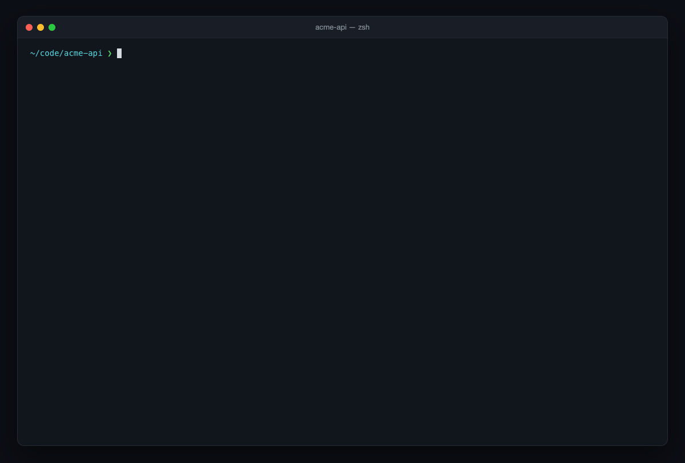

# agent-ready v0.1.0

**Lighthouse for AI coding agents.** One command scores how well Claude Code, Codex, Cursor and
Copilot can work in your repo (0–100), shows exactly why, and fixes the easy gaps for you.

```bash
npx @mintwork/agent-ready          # score this repo
npx @mintwork/agent-ready --fix    # generate AGENTS.md + CLAUDE.md, fix .gitignore (prints a diff)
npx @mintwork/agent-ready --badge  # README badge
```



## Why

Your agent is only as good as the repo you drop it into. Without an `AGENTS.md` it guesses your
test command. A stale `CLAUDE.md` sends it to edit files that were deleted months ago. An unignored
`dist/` burns its context window on minified bundles. A `build` script that runs `npm publish`
turns "let me check the build" into a release.

`agent-ready` checks for these failure modes in under a second, with no network calls and no code
execution (unless you pass `--run`).

## What's in 0.1.0

- **Five weighted categories**: Context docs (30%), Feedback loops (25%), Navigability (20%),
  Type safety (15%) and Safety (10%), with a punch list of findings and suggested fixes.
- **Staleness detection**: every path and `npm run` script your agent docs mention is checked
  against the repo.
- **`--fix`**: creates a starter `AGENTS.md` + `CLAUDE.md` from your real scripts and layout,
  appends missing sections and `.gitignore` entries. It is conservative: diffs always, no
  overwrites without `--force`, and `--dry-run` to preview.
- **Honest scoring for generated docs**: an unedited `--fix` template earns at most half credit.
  The CLI tells you how many points you unlock by filling in the TODOs, so the badge reflects
  context written by people who know the code.
- **`--badge`** for your README, **`--json`** for tooling, and **`--min-score`** for CI.
- **GitHub Action**: `uses: mintwork/agent-ready@v0` with a `score` output and a job summary.
- **Languages**: JS/TS and Python, basic Go and Rust, with polyglot weighting by language share.
- **Extensible**: plain-object checks via the programmatic API. Zero runtime dependencies.

## Validation

Before release we ran agent-ready against 13 well-known open-source repositories, and the scores
tracked expert judgment of how easy each one is for an agent to work in. Each heuristic that
misfired on a real repo became a regression test, using synthetic snippets.

## GitHub Action

```yaml
- uses: actions/checkout@v7
- uses: mintwork/agent-ready@v0
  with: { min-score: 75 }
```

`@v0` follows the latest 0.x release; pin `@v0.1.0` for a fixed version.

## Known limitations

- Go and Rust support is basic (presence of tooling and compiler checks, not deeper analysis).
- Monorepos are scored as one unit; per-package scores are on the roadmap.
- Scoring weights may still be tuned before 1.0. Changes that move scores will be in the changelog.

Full changelog: [CHANGELOG.md](../CHANGELOG.md)
